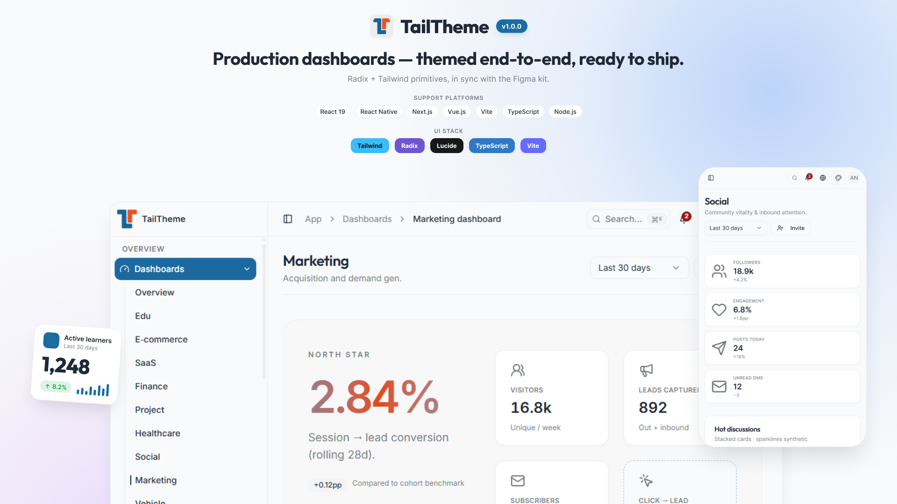

<div align="center">



# TailTheme React Full

**The complete collection of dashboards, product pages, and UI patterns — ready to make your own.**

Build dashboards, SaaS consoles, and internal tools with React, TypeScript, Vite, and Tailwind CSS. **Free and open source. MIT licensed.**

[Website](https://tailtheme.ezway.tech/) · [Live demo](https://tailtheme-demo.ezway.tech) · [Figma](https://www.figma.com/design/OjGoqhtHI9gzspszsDQ7Va/TailTheme-Web) · [Documentation](#documentation) · [Lite edition](https://github.com/ezway-tech/tailtheme-reactjs-lite)

[](LICENSE)
[](https://react.dev)
[](https://www.typescriptlang.org)
[](https://tailwindcss.com)

</div>

<sub>Original TailTheme brand preview. The image shows the wider design collection; the features included in this React Full edition are listed below.</sub>

---

## Overview

**TailTheme React Full** is the canonical open-source template for TailTheme on the web: Vite, React 19, TypeScript, and Tailwind CSS v4.

Use it as a reference implementation, a starting point for admin UIs, or the source for smaller exports. Auth screens and sample data are **frontend demos** — there is no real TailTheme commerce API to configure for local viewing. Optional MSW demo mode: `?mock=1`.

## Lite or Full?

Both editions are **free**, **MIT**, and share the same design system. They differ only in how many pages and samples ship with the repo.

|               | **Lite**                                         | **Full** (this repo)                  |
| ------------- | ------------------------------------------------ | ------------------------------------- |
| Scope         | Dashboards, SaaS/Project samples, UI docs subset | Complete demo and component reference |
| Exporter      | —                                                | `npm run create:project`              |
| Shared UI PRs | Prefer Full                                      | Yes                                   |

Lite is refreshed from this repository with `npm run sync:lite` (preset `lite`). The separate `minimal` preset is a small Home/Form starter for `create:project` exports — not the public Lite edition.

## 📦 What's included

| Area                 | What you get                                                                                     |
| -------------------- | ------------------------------------------------------------------------------------------------ |
| **Dashboards**       | Overview, SaaS, Project, and industry dashboard examples                                         |
| **Product pages**    | Education, commerce, SaaS, finance, project, health, social, marketing, vehicle, and CRM samples |
| **UI components**    | Reusable primitives, advanced inputs, data tables, charts, and pattern showcases                 |
| **App shell**        | Responsive navigation, breadcrumbs, command palette, and header utilities                        |
| **Appearance**       | Semantic design tokens, light/dark themes, and theme preferences                                 |
| **Account screens**  | Authentication, profile, and settings examples                                                   |
| **Design resources** | Figma foundations and reference components                                                       |

> Authentication and sample data are frontend demonstrations. Connect your own backend for a real application.

---

## 🚀 Quick start

Use **Node.js 22 LTS** and npm.

```bash
npm install
cp .env.example .env
npm run dev
```

Default app URL: [http://localhost:5173](http://localhost:5173) (override with `VITE_APP_PORT` in `.env`).

Useful checks:

```bash
npm run typecheck
npm run lint
npm run test:run
npm run build
```

## Customization

| Area                    | Location                                                           |
| ----------------------- | ------------------------------------------------------------------ |
| App name / storage keys | [`src/config.ts`](src/config.ts)                                   |
| Design tokens           | [`src/styles/globals.css`](src/styles/globals.css)                 |
| Navigation              | [`src/navigation/app-nav-tree.ts`](src/navigation/app-nav-tree.ts) |
| Routes / URLs           | [`src/routes/`](src/routes/)                                       |
| Sample fixtures         | [`src/mocks/fixtures/`](src/mocks/fixtures/)                       |

Longer walkthrough: [`docs/customization.md`](docs/customization.md).

## 📖 Documentation

| Doc                                                          | Description                 |
| ------------------------------------------------------------ | --------------------------- |
| [`docs/customization.md`](docs/customization.md)             | Branding, theme, navigation |
| [`docs/create-project.md`](docs/create-project.md)           | Project export / presets    |
| [`docs/figma-tailtheme-web.md`](docs/figma-tailtheme-web.md) | Figma file notes            |
| [`docs/components.md`](docs/components.md)                   | Component documentation     |
| [`docs/tokens-overview.md`](docs/tokens-overview.md)         | Token overview              |
| [`docs/code-connect.md`](docs/code-connect.md)               | Optional Figma Code Connect |
| [`DESIGN.md`](DESIGN.md)                                     | Design principles           |
| [`CONTRIBUTING.md`](CONTRIBUTING.md)                         | How to contribute           |

In-app UI gallery (after `npm run dev`): `/app/ui` — this is an app route, not a GitHub docs path.

## 🎨 Figma

Design file: [TailTheme Web](https://www.figma.com/design/OjGoqhtHI9gzspszsDQ7Va/TailTheme-Web)

Explore foundations, theme variables, and reference components alongside the React implementation. See [`docs/figma-tailtheme-web.md`](docs/figma-tailtheme-web.md).

## Scripts

| Script                            | Purpose                  |
| --------------------------------- | ------------------------ |
| `npm run dev`                     | Start Vite dev server    |
| `npm run build`                   | Production build         |
| `npm run preview`                 | Preview production build |
| `npm run typecheck`               | TypeScript check         |
| `npm run lint` / `lint:fix`       | ESLint                   |
| `npm run format` / `format:check` | Prettier                 |
| `npm run test:run`                | Unit tests               |
| `npm run test:create-project`     | Exporter tests           |
| `npm run create:project`          | Export a tailored app    |
| `npm run sync:lite`               | Regenerate the Lite repo |

## Contributing

See [`CONTRIBUTING.md`](CONTRIBUTING.md). Shared UI, tokens, generator, and docs belong in **this** repository so Lite can stay regeneratable.

## ☕ Support the project

TailTheme is free and open source. If it saves you time, consider supporting its maintenance. Starring the repository, reporting bugs, improving the docs, and sharing it also help.

<!-- Maintainer: add the donation URL here when available. -->

## License

MIT — Copyright (c) 2026 **Ezway Tech**. TailTheme is the product name.

See [`LICENSE`](LICENSE). Third-party notices: [`THIRD_PARTY_NOTICES.md`](THIRD_PARTY_NOTICES.md).

---

<div align="center">

Built by **Ezway Tech** · [Website](https://tailtheme.ezway.tech/) · [Figma](https://www.figma.com/design/OjGoqhtHI9gzspszsDQ7Va/TailTheme-Web) · [MIT License](LICENSE)

</div>
